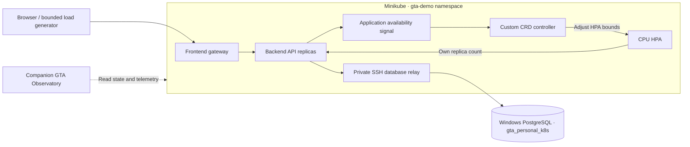
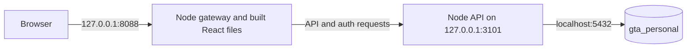

# GTA Personal Infrastructure

A personal platform-engineering project for the
[GTA Application System](https://github.com/retherrien/gtaApplication): native local
development, Linux container packaging, Minikube deployment, a custom availability
autoscaler, and prepared infrastructure for a short-lived AWS EKS demonstration.

**Companion project:** [GTA Observatory](https://github.com/Srijan229/gta-observatory)
provides live topology, request waterfalls, resource charts, alerts and controlled
load generation without Prometheus.

> Native and Minikube deployments have been exercised locally. EKS configuration
> is prepared and Terraform-validated; no actual AWS deployment has been performed.
> This is a personal demonstration, separate from the university production setup.

## What this project demonstrates

- An `ApplicationScalingPolicy` CRD and namespace-scoped custom controller.
- Availability-aware capacity: an active phase **and** an available course section
  raise the backend minimum from 1 to 3 replicas.
- CPU HPA as the sole writer of Deployment replica counts, capped at 5 replicas.
- Prewarming, cooldown, and retention of existing bounds when signals go stale.
- Private Services, isolated migrations, restricted service accounts and a reverse
  SSH connection to a dedicated laptop PostgreSQL database.
- Correlated frontend/backend/Prisma timings through personal container overlays.
- Reproducible source pins, Windows/Linux checks, and an explicit EKS cleanup plan.

## Kubernetes architecture



| Profile | Runtime | Local URL | Storage |
| --- | --- | --- | --- |
| Native app | Node 20 + PostgreSQL 18 | http://127.0.0.1:8088 | `gta_personal` |
| Kubernetes app | Docker Desktop + Minikube | http://127.0.0.1:18088 | `gta_personal_k8s` |
| Companion dashboard | Separate Observatory container | http://127.0.0.1:19090 | Bounded chart-history PVC |

The application checkout, credentials, database backups and logs remain ignored.
The source is private: native preparation requires authorized upstream access;
image builds require access to the verified private release archive configured in
`config/local.json`. Authenticate Git/GitHub CLI in your terminal, not in a tracked file.

## Native development architecture



The gateway gives the browser one origin for static files, API requests and sign-in
routes. Both workers bind to loopback. This first profile uses the application's
local development identity controls. Power Automate, GMU SSO and inherited external
integration settings are cleared from its process environment. Internet hosting
requires a separate authenticated profile.

## Prerequisites

- Node 20 and npm, Git, PostgreSQL 18 server and client tools.
- PostgreSQL must already be running. Use a local database role that can create and
  own `gta_personal`, or have an administrator create that empty database first.
- Personal app ports are 3101 and 8088. Existing development services on 3001/5173
  can keep running. PostgreSQL normally uses 5432.

No Docker installation is required for the native profile. The original application's container files and
university deployment remain in the upstream repository.

## First run

```powershell
Copy-Item .env.example .env
# Edit .env: set DATABASE_URL using your local PostgreSQL credentials.
# Set PG_BIN if PostgreSQL client tools are not in PATH.
npm run infra -- doctor
npm run infra -- plan
npm run infra -- prepare
npm run infra -- start
npm run infra -- status
```

Open **http://127.0.0.1:8088**. On Linux the equivalent copy command is
`cp .env.example .env`. These scripts use built-in Node modules and need no
infrastructure package installation. The `prepare` command installs the app's
locked dependencies and builds its frontend in `.local/source`.

`prepare` checks out the pinned source revision from `config/local.json`, creates
`gta_personal` if needed, saves a backup, validates Prisma, applies that revision's
migrations and builds React. It never loads sample records. The initial database
is empty; create your own fictional profiles and course data through the app.

Only a local database named `gta_personal` passes the configuration guard.

## Daily commands

| Command | Purpose |
| --- | --- |
| `npm run infra -- plan` | Show the source pin, database name and ports without revealing credentials. |
| `npm run infra -- doctor` | Check Node, Git, PostgreSQL tools, server version and database target. |
| `npm run infra -- prepare` | Fetch the app, install/build it, and apply its migrations after a backup. Stop personal workers first. |
| `npm run infra -- start` | Start owned workers and wait for healthy responses. |
| `npm run infra -- status` | Report worker ownership and HTTP health. |
| `npm run infra -- stop` | Stop workers started here. PostgreSQL keeps running. |
| `npm run infra -- backup` | Save a custom-format PostgreSQL backup under `.local/backups`. |
| `npm test` | Verify isolation, configuration and gateway behavior without a database. |

Worker logs are `.local/backend.log` and `.local/gateway.log`. Saved PIDs include
unique process tokens; stop verifies ownership before terminating a worker.
HTTP health checks confirm service availability; use a database query and an
application workflow test to check the complete deployment.

## Updating the application

1. Stop the personal workers and create a backup.
2. Review upstream changes, especially migrations, auth and runtime requirements.
3. Change `sourceRevision` to the reviewed full commit ID in `config/local.json`.
4. Update the verified source archive and SHA in `sourceArchive` together with the
   source pin before building new images.
5. Run `doctor`, `prepare`, `start` and `status`, then test the relevant screens.

The source is fetched into a detached checkout. Local edits cause `prepare` to stop
so you can preserve them. No command pushes code to the professor's repository.
The personal deployment currently tracks upstream main; the separate Insights PR
was closed without merging and is not included in this pinned revision.

## Project layout

- `config/local.json`: versioned runtime plan and source pin.
- `scripts/`: setup, worker lifecycle, local gateway and backup commands.
- `test/`: checks that run on Windows and Linux in GitHub Actions.
- `docs/`: decisions and the next deployment stages.
- `.env`: ignored machine configuration and database secret.
- `.local/`: ignored source checkout, build output, process state and backups.

Windows checks cover the native profile. Linux containers and Kubernetes behavior
have also been exercised locally in Minikube. TLS, real SSO, EKS IAM/networking and
cloud lifecycle still require separate verification. Local setup creates no AWS resources.

## Kubernetes and short EKS portfolio demo

The `eks-demo-prep` work adds an `ApplicationScalingPolicy` CRD/controller,
container packaging, private Kubernetes services, CPU HPA, a reverse PostgreSQL
tunnel, Terraform for an ephemeral EKS cluster, and a Linux Kubernetes rehearsal.
The controller uses active application phases and available course sections to
raise the minimum replica count, and retains capacity if that signal fails.

See [architecture](docs/eks/architecture.md) and the
[one-hour cloud runbook](docs/eks/one-hour-runbook.md). Cloud creation requires the
user's separate go-ahead. The automatic rehearsal runs only in GitHub's Linux
runner and creates no AWS resources. The AWS image publisher is manual and uses
short-lived OIDC credentials; deployment and cleanup remain explicit steps.

### Local Minikube deployment

Docker Desktop must be running. This profile uses the existing `minikube` cluster,
the isolated `gta-demo` namespace, and only the dedicated `gta_personal_k8s`
PostgreSQL database. It does not require AWS access. Use Node 20 for these commands.

```powershell
minikube start -p minikube --driver=docker --cpus=2 --memory=4096
# Complete native prepare first; create only the separate demo DB and limited login.
node --env-file=.env scripts/prepare-demo-db.mjs
node scripts/build-images.mjs
docker save -o .local/build/minikube-images.tar gta-backend:demo gta-frontend:demo gta-controller:demo gta-relay:demo
minikube -p minikube image load .local/build/minikube-images.tar --overwrite
kubectl --context=minikube config view --minify --flatten --raw | Set-Content .local/k8s/minikube-kubeconfig -Encoding ascii
./scripts/deploy-demo.ps1 -LocalMinikube
```

The ignored `.local/k8s/laptop.env` is created by the dedicated demo database
preparation step in the cloud runbook; never substitute the reference database.
Open **http://127.0.0.1:18088**. Port 8088 is the separate native Node app.
Keep the owned port-forward and reverse SSH processes running for database access.
Keys, database credentials, kubeconfigs and process logs remain ignored.

To inspect the controller and run the isolated scaling demonstration:

```powershell
$env:KUBECONFIG = "$PWD/.local/k8s/minikube-kubeconfig"
$env:GTA_LOCAL_MINIKUBE = 'true'
kubectl -n gta-demo get pods,hpa,asp
node scripts/k8s-demo.mjs
```

The demonstration changes two owned fictional phase/section records, then sends
temporary HTTP traffic. It does not create applicants or run repository seeds.
The CRD changes HPA bounds; HPA remains the sole writer of backend replica counts.

Stop the owned tunnels with `./scripts/deploy-demo.ps1 -LocalMinikube -Stop`.
`minikube stop -p minikube` also stops other workloads in that existing cluster.
The local rehearsal validates Linux containers and Kubernetes behavior; EKS IAM,
networking and infrastructure still require separate AWS verification.

### Add visual observability

Follow [GTA Observatory's setup](https://github.com/Srijan229/gta-observatory#local-setup-and-lifecycle)
in a separate checkout. The images built here include its timing instrumentation.
The collector requires no database credentials, and its app-namespace Kubernetes
access is read-only. Its load controls send bounded read-only requests through the
frontend gateway.

## Validation and demonstration results

- Nine tests cover database isolation, runtime settings, gateway forwarding,
  availability decisions, reconciliation, manifest permissions and trace privacy.
- Prisma validation, production frontend builds and the pinned app's 42 migrations
  were exercised against isolated personal databases without repository seeds.
- Minikube exercised Linux images, the private database tunnel, migration Job,
  controller reconciliation, 1 → 3 → 1 availability scaling and CPU-driven scaling.
- Observatory integration exercised correlated HTTP/Prisma spans and bounded load
  start/stop. These are functional checks, not a large-user performance benchmark.
- GitHub Actions runs tests on Windows and Linux. Check the separate kind rehearsal
  workflow's current result before using its tested-image artifacts for EKS.

See [verification notes](docs/verification.md). Browser layout review and real AWS
deployment remain separate checks. HPA reacts to sampled metrics; replica changes
are not instantaneous. The one-hour cloud session is a target, not a spending cap.

## Data isolation and attribution

This repository contains personal infrastructure, controller and packaging work.
The original GTA application is maintained in
[retherrien/gtaApplication](https://github.com/retherrien/gtaApplication); its
application authorship is not claimed here. University reference databases and
production deployments are not modified by the personal profiles.

Never commit credentials, SSH keys, kubeconfigs, applicant uploads, database data
or backups, Terraform state/plans, image archives or process logs. Personal demo
identity controls are not production authentication; public hosting requires
proper sign-in and authorization.
