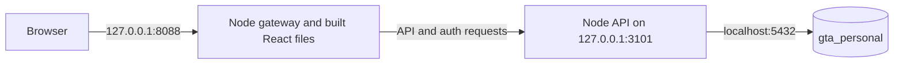

# GTA Personal Infrastructure

A personal deployment workspace for [gtaApplication](https://github.com/retherrien/gtaApplication).
It runs a pinned application release locally with native Node 20 and PostgreSQL 18.
The application checkout, credentials, database backups and logs stay under ignored paths.



The gateway gives the browser one origin for static files, API requests and sign-in
routes. Both workers bind to loopback. This first profile uses the application's
local development identity controls. Power Automate, GMU SSO and inherited external
integration settings are cleared from its process environment. Internet hosting
requires a separate authenticated profile.

## Prerequisites

- Node 20 and npm, Git, PostgreSQL 18 server and client tools.
- PostgreSQL must already be running. Use a local database role that can create and
  own `gta_personal`, or have an administrator create that empty database first.
- Personal app ports are 3101 and 8088. Existing development services on 3001/5173
  can keep running. PostgreSQL normally uses 5432.

No Docker installation is required. The original application's container files and
university deployment remain in the upstream repository.

## First run

```powershell
Copy-Item .env.example .env
# Edit .env: set DATABASE_URL using your local PostgreSQL credentials.
# Set PG_BIN if PostgreSQL client tools are not in PATH.
npm run infra -- doctor
npm run infra -- plan
npm run infra -- prepare
npm run infra -- start
npm run infra -- status
```

Open **http://127.0.0.1:8088**. On Linux the equivalent copy command is
`cp .env.example .env`. These scripts use built-in Node modules and need no
infrastructure package installation. The `prepare` command installs the app's
locked dependencies and builds its frontend in `.local/source`.

`prepare` checks out the pinned source revision from `config/local.json`, creates
`gta_personal` if needed, saves a backup, validates Prisma, applies that revision's
migrations and builds React. It never loads sample records. The initial database
is empty; create your own fictional profiles and course data through the app.

Only a local database named `gta_personal` passes the configuration guard.

## Daily commands

| Command | Purpose |
| --- | --- |
| `npm run infra -- plan` | Show the source pin, database name and ports without revealing credentials. |
| `npm run infra -- doctor` | Check Node, Git, PostgreSQL tools, server version and database target. |
| `npm run infra -- prepare` | Fetch the app, install/build it, and apply its migrations after a backup. Stop personal workers first. |
| `npm run infra -- start` | Start owned workers and wait for healthy responses. |
| `npm run infra -- status` | Report worker ownership and HTTP health. |
| `npm run infra -- stop` | Stop workers started here. PostgreSQL keeps running. |
| `npm run infra -- backup` | Save a custom-format PostgreSQL backup under `.local/backups`. |
| `npm test` | Verify isolation, configuration and gateway behavior without a database. |

Worker logs are `.local/backend.log` and `.local/gateway.log`. Saved PIDs include
unique process tokens; stop verifies ownership before terminating a worker.
HTTP health checks confirm service availability; use a database query and an
application workflow test to check the complete deployment.

## Updating the application

1. Stop the personal workers and create a backup.
2. Review upstream changes, especially migrations, auth and runtime requirements.
3. Change `sourceRevision` to the reviewed full commit ID in `config/local.json`.
4. Run `doctor`, `prepare`, `start` and `status`, then test the relevant screens.

The source is fetched into a detached checkout. Local edits cause `prepare` to stop
so you can preserve them. No command pushes code to the professor's repository.
The personal deployment currently tracks upstream main; the separate Insights PR
was closed without merging and is not included in this pinned revision.

## Project layout

- `config/local.json`: versioned runtime plan and source pin.
- `scripts/`: setup, worker lifecycle, local gateway and backup commands.
- `test/`: checks that run on Windows and Linux in GitHub Actions.
- `docs/`: decisions and the next deployment stages.
- `.env`: ignored machine configuration and database secret.
- `.local/`: ignored source checkout, build output, process state and backups.

Windows checks cover the native local profile. Linux process management, container
builds, TLS, firewall rules and real SSO need validation when hosting is chosen.
No cloud resources are provisioned by this first version.

## Kubernetes and short EKS portfolio demo

The `eks-demo-prep` work adds an `ApplicationScalingPolicy` CRD/controller,
container packaging, private Kubernetes services, CPU HPA, a reverse PostgreSQL
tunnel, Terraform for an ephemeral EKS cluster, and a Linux Kubernetes rehearsal.
The controller uses active application phases and available course sections to
raise the minimum replica count, and retains capacity if that signal fails.

See [architecture](docs/eks/architecture.md) and the
[one-hour cloud runbook](docs/eks/one-hour-runbook.md). Cloud creation requires the
user's separate go-ahead. The automatic rehearsal runs only in GitHub's Linux
runner and creates no AWS resources. The AWS image publisher is manual and uses
short-lived OIDC credentials; deployment and cleanup remain explicit steps.
