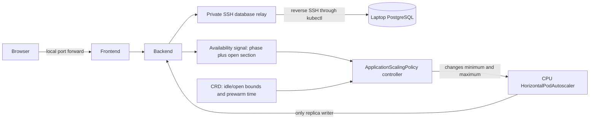

# Portfolio Kubernetes architecture

The pinned application's source stays intact. Its backend packaging overlay exposes
an internal availability endpoint on 3002 and disables duplicate in-process
schedulers. `/readyz` verifies database access. The frontend packages a built React
application with a small same-origin proxy. Backend and frontend need no Kubernetes
API token; the controller has only namespace-scoped policy/status and named-HPA
permissions. One controller replica uses Recreate rollouts.

Availability requires at least one active application phase and one active,
unassigned imported section. Policies can prewarm before a configured opening
time, apply a cooldown after availability closes, and retain capacity when the
signal is stale or unavailable. HPA alone changes Deployment replicas. This
controller demonstrates business-aware pod scaling, not node provisioning.

Migrations run once in a bounded Job before the backend is deployed. A suspended
hourly CronJob shows how interview expiry can be separated from backend replicas;
it remains suspended for the short demo. Power Automate is not configured.

The Linux CI rehearsal runs real Kubernetes 1.36 using kind. PostgreSQL runs outside
the cluster on the runner, connected using the same reverse-forward design planned
for the laptop. Tested images and sanitized scaling evidence are private artifacts.
Image building reads a checksum-pinned private source snapshot because the upstream
repository requires separate authorization. No personal access token is needed in
the build. Source assets and images stay in the user's private repository.

The AWS profile uses a single managed worker and no public application ingress.
It is optimized for a short portfolio demonstration and has no high-availability
claim. Real EKS IAM, networking and lifecycle checks remain pending until the
user-approved AWS session; an emulator or a CI kind cluster cannot prove those.
